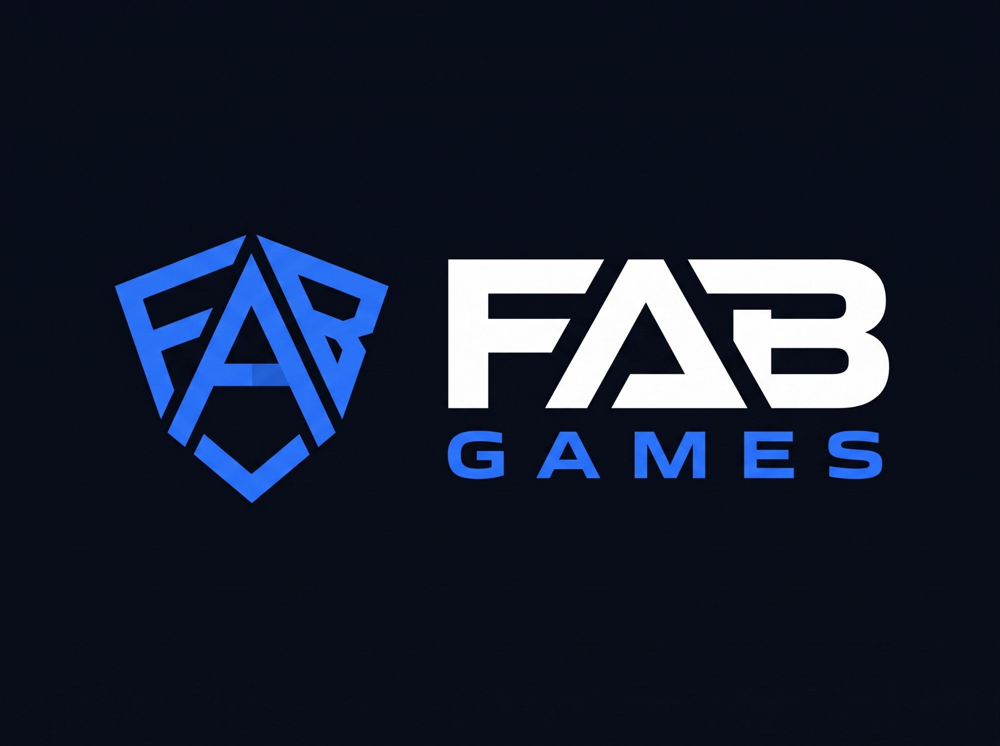

<p align="center">
  
</p>

# FAB Games

An ad-free, real-time multiplayer board game site for playing with friends. Chess and checkers at launch, a console-style home screen, no accounts, no trackers.

- **Server-authoritative.** Clients only send intents. The server validates every move, detects the end of the game and broadcasts the state.
- **Pluggable games.** A new game is one project that implements `IGameEngine`, one DI registration, one state mapper and one board renderer. Rooms, the hub and the transport do not change.
- **Real time.** ASP.NET Core SignalR, with reconnection (a refresh keeps your seat), server-owned clocks, draw offers, rematches and chat.
- **Original UI.** Boot sequence, profile select and a dashboard of game tiles, played with mouse, touch, keyboard or gamepad. Spanish and English.
- **Private by construction.** No analytics, no third-party requests, self-hosted fonts, a strict content security policy, and secret player ids that never leave the server.

## Run it

Requires the .NET 10 SDK.

```bash
dotnet run --project src/FabGames.Web
```

Then open <http://localhost:5256>. To play yourself, open two tabs (each tab is its own player), create a room in one and join with the code in the other.

```bash
dotnet test
```

Settings live in `src/FabGames.Web/appsettings.json` (`Rooms`: room limit, disconnect grace period, idle timeouts; `HubRateLimit`).

## Layout

```text
src/
  FabGames.Core/            IGameEngine contract, RoomManager, room codes, clocks
  FabGames.Games.Chess/     complete chess rules, FEN, SAN, perft-verified move generation
  FabGames.Games.Checkers/  English draughts: mandatory capture, multi-jumps, crowning
  FabGames.Web/             MVC + SignalR host, DTO mapping, background services, the front-end
tests/                      xUnit: engines, room manager (concurrency, clocks), hub and page integration
tools/                      UI strings (strings.py) and the resx generator
docs/                       decisions, design directions
```

Hosting notes: rooms are in memory, so run a single instance. Behind IIS, enable the **WebSocket Protocol** feature.

## Docs

- [`docs/DECISIONS.md`](docs/DECISIONS.md): where the build differs from the brief, and why
- [`PRODUCT.md`](PRODUCT.md), [`DESIGN.md`](DESIGN.md): product context and the chosen design direction
- [`THIRD-PARTY-NOTICES.md`](THIRD-PARTY-NOTICES.md)

## License

[PolyForm Noncommercial 1.0.0](LICENSE.txt).
