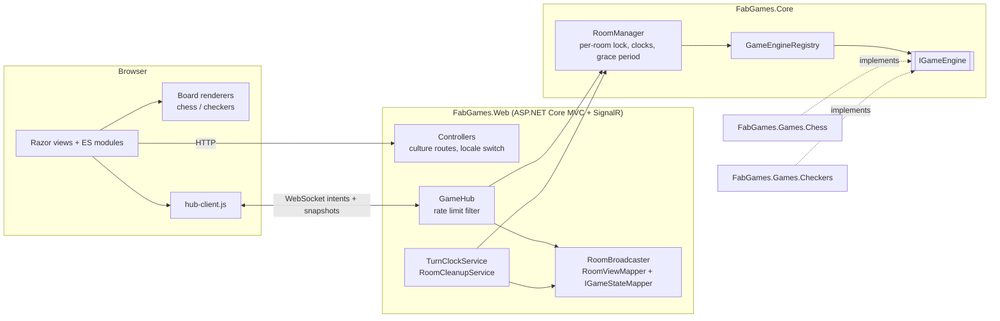
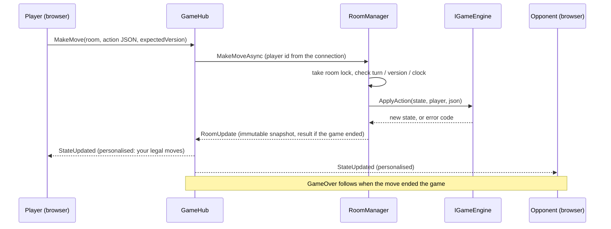

# FAB Games — build report

State at the end of the build: Phases 0–6 complete on branch `feature/foundation`. 0 warnings, 196 automated tests green, every screen checked at four widths in Spanish and English.

## 1. Architecture



A move, end to end:



Key properties:

- **The server decides everything.** The client sends an intent; the engine validates it; every client receives a fresh full snapshot with a monotonically increasing `StateVersion`. The client highlights only the legal moves the server sent.
- **Engines are stateless and immutable.** `IGameEngine` works on state objects it creates; the room layer owns time, turn order, draw offers, resignation, rematches and disconnects.
- **Concurrency**: one `SemaphoreSlim` per room, always taken in `try/finally`, disposed deterministically when the room is removed and the last user leaves.
- **Privacy**: clients send a secret player id; every outgoing message uses a hashed public id.

## 2. How to run

```bash
dotnet run --project src/FabGames.Web   # http://localhost:5256
dotnet test                              # 196 tests
python tools/gen_resx.py                 # after editing tools/strings.py
```

To play yourself open two tabs (each tab is a separate player): create a room in one, join with the code in the other. Settings are in `appsettings.json` (`Rooms`, `HubRateLimit`).

## 3. How to add a third game

The test project proves this works: `tests/FabGames.Core.Tests/NimEngine.cs` is a complete third game that plugs into the unchanged `RoomManager` and passes the full room test-suite.

1. **Engine project.** Create `FabGames.Games.<Name>` referencing `FabGames.Core`. Derive from `GameEngineBase<TState, TAction>` and implement:

   | Member | Purpose |
   |---|---|
   | `GameTypeId`, `MinPlayers`, `MaxPlayers` | Identity and seat count |
   | `NewGame(ids)` | Initial immutable state; `ids[i]` plays colour `i` |
   | `Apply(state, playerId, action)` | Validate and apply one complete turn; return `GameActionResult` with an error code or the new state (and a `GameResult` if it ended the game) |
   | `GetCurrentTurnPlayerId`, `GetLegalActions`, `GetResult` | Turn order, UI hints, game end |
   | `Resign`, `DeclareTimeout` | Results for forced endings |

   Add `AddXGame()` calling `services.AddGameEngine<XEngine>()`.
2. **Compose it.** In `FabGames.Web`: reference the project and call `AddXGame()` and `AddSingleton<IGameStateMapper, XStateMapper>()` in `Program.cs`. The mapper turns the engine state into a DTO (board, last move, legal moves for the recipient).
3. **Renderer.** Add `wwwroot/js/games/x-board.js` (build on `BoardCore`, or any renderer with `update()`, `describeMove()`, `isCapture()`) and one line in `js/games/registry.js`.
4. **Content.** Add `home.x.title`, `home.x.desc`, `how.x.N` and `color.x.*` to `tools/strings.py` and run the generator; add a tile to `HomeController` and a cover under `wwwroot/img/covers`.

Rooms, the hub, the transport, clocks, reconnection, chat, draw offers and rematches need no change.

## 4. What was verified

| Area | Evidence |
|---|---|
| Chess rules | 68 tests: every movement rule, en passant, promotion, each blocked castling case, pins, mate, stalemate, insufficient material, threefold, fifty-move. Perft matches the reference (start position depth 1–4 = 20 / 400 / 8,902 / 197,281; Kiwipete depth 1–3 = 48 / 2,039 / 97,862) plus three more reference positions. |
| Checkers rules | 28 tests: mandatory capture, free choice among sequences, multi-jump atomicity, crowning ends the turn, kings move one square, no-moves loss, configurable draw rule. |
| Rooms | 46 tests: 100 parallel moves give exactly one accepted move; join race for the last seat; clocks and increment on a fake clock; timeout; disconnect grace, reconnect, forfeit; idle cleanup, including a cleanup racing in-flight calls. A third game (Nim) runs on the same manager. |
| Hub and pages | 54 tests with real SignalR clients: Fool's Mate to checkmate, rejections with codes, chat as text, draw / resign / rematch with colour swap, refresh mid-game, abandonment, timeout, rate limiting, a checkers forced capture; culture routing, localization in both languages, CSP, no inline script or style, no third-party host, static assets. |
| Browser, two tabs | Created a room in one tab and joined from the other by typing the code (lowercase) in the Spanish UI. Played Fool's Mate (click and drag input) and a checkers line with a forced capture and a stepwise double jump (`a3xc5xa7`). Exercised chat (HTML shown as text), draw offer / decline / accept, resign, rematch with colour swap, refresh mid-game, illegal-move attempts (ignored, board unchanged). |
| Keyboard | Boot skip, profile pick, tile navigation, opening and closing dialogs (focus returns to the opener), all by keys only. |
| Layout | No layout shift on the home page (CLS 0). Screenshots of boot, profile select, dashboard, lobby, chess game, checkers game and result banner at 1920, 1280, 768 and 390 px in Spanish and English: 56 files in `docs/screenshots/`. |
| Accessibility sweep | Script over the live pages: every control has an accessible name, every image has alt text, no duplicate ids, one landmark, dialogs labelled, no positive tabindex, no touch target under 32 px, a polite live region for moves. It found a missing page heading on the room screen, which is fixed. |

## 5. Critique and audit

The named skills (`impeccable`, `design-taste-frontend`, `emil-design-eng`) and the Playwright MCP were not available, so the critique was done by hand against `PRODUCT.md` and `DESIGN.md`, using the built-in browser and DOM checks. Defects found and fixed:

- The boot overlay was visible in the HTML, so on a return visit it covered the dashboard and swallowed input (fixed: it starts `hidden`).
- A rematch restarts at state version 1 with the same `gamesPlayed`, so the client dropped the new game's first snapshot as stale (fixed: games are keyed by room and start time).
- A refresh raced the rejoin response against the server's state push and could create two boards, leaving an empty one (fixed: snapshots are applied serially).
- Pressing a piece selected it and the release then deselected it (fixed: press-to-select, press-again-to-release).
- SignalR event handlers returned a value, which SignalR sent back to the server as a result (fixed).
- The last-move highlight went muddy brown on the light marble (fixed: lighter fill with a clear outline).
- Pearl pieces lacked contrast on the light squares (fixed: darker, bluer marble).
- File letters collided with piece bases (fixed: moved to the left edge of the square).
- The preselected profile did not look selected until a key was pressed (fixed).
- "Próximamente" was clipped on narrow tiles (fixed with a container-query title size; verified 120/120 px).
- Large screens looked small for TV distance (fixed: root font size scales from 1600 px).
- No page heading on the lobby and game screens (fixed: visually hidden `h1`).

## 6. Known limitations

- **Single instance, in memory.** Rooms live in process memory: a restart ends every game. Scaling out would need a Redis SignalR backplane plus an external room store, and sticky or externalised clocks.
- **Unverified here**: gamepad input (the Gamepad API code is written and reviewed, but no controller was available); the `prefers-reduced-motion` styles (reviewed, but the browser pane cannot emulate the setting); the synthesized sounds (no audio output was available, so they were not heard); real phones (checked only at emulated phone sizes).
- **No automated browser tests.** Front-end behaviour was verified by hand in the built-in browser; only the server side is under automated test.
- **Documentation screenshots are low resolution**: the browser pane returns images at most about 800 px wide, so the 1920 px captures are downscaled.
- **Identity is per tab.** The player id lives in `sessionStorage`; clearing it makes you a new player, and a profile's local stats are shared by every tab using that profile. Anyone with a room code can take a free seat.
- **Fonts are Latin-subset** (enough for Spanish and English).
- **Checkers rules are fixed** to English draughts (no flying kings, no maximum-capture rule), with the move limit configurable in code (`new CheckersEngine(n)`).
- `ClockTick` is not pushed; clients count down from the server timestamp.
- The rate limit is per connection, not per address.
- Two unrelated files from the project owner sit untracked in the repository root (`CLAUDE.md` describes a different architecture and conflicts with the brief; see `DECISIONS.md`).

## 7. Hosting notes

- **IIS** needs the **WebSocket Protocol** feature enabled (Server Manager → Add Roles and Features → Web Server → Application Development → WebSocket Protocol); without it SignalR falls back to long polling.
- **Run a single instance**, because rooms are in memory. Do not put it behind a load balancer without a backplane and shared state.
- HTTPS redirection and HSTS are on outside Development; terminate TLS at the proxy and forward `X-Forwarded-Proto`.
- Same-origin hosting means no CORS policy is configured.
- The content security policy allows `ws:` and `wss:` for the hub and nothing else off-origin; a reverse proxy must not add inline scripts.

## 8. Screenshots

`docs/screenshots/<screen>-<lang>-<width>.jpg` for screens `boot`, `profiles`, `dashboard`, `lobby`, `chess-game`, `checkers-game`, `gameover`; languages `es`, `en`; widths `1920`, `1280`, `768`, `390`.
